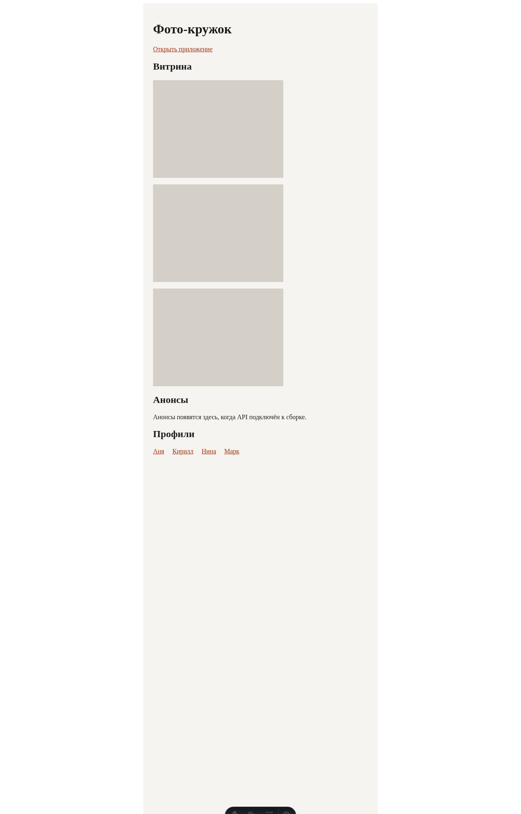
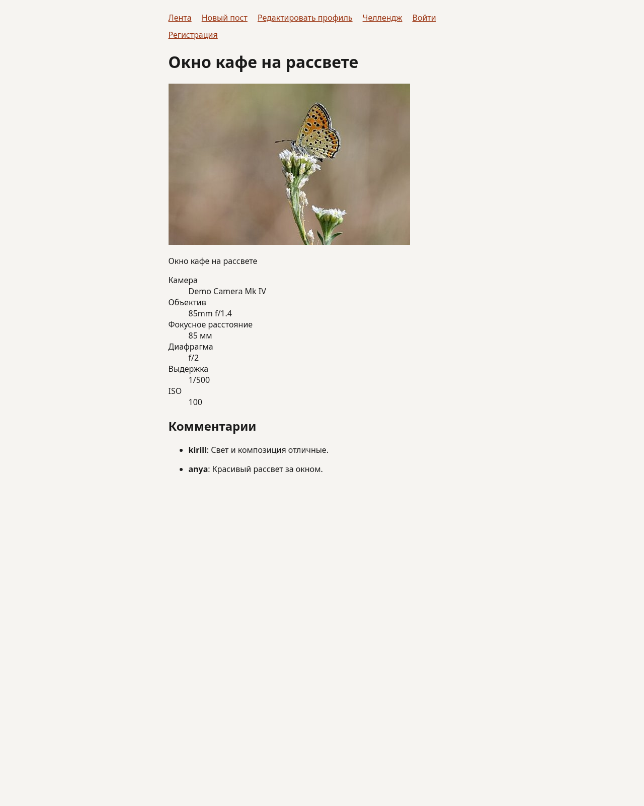
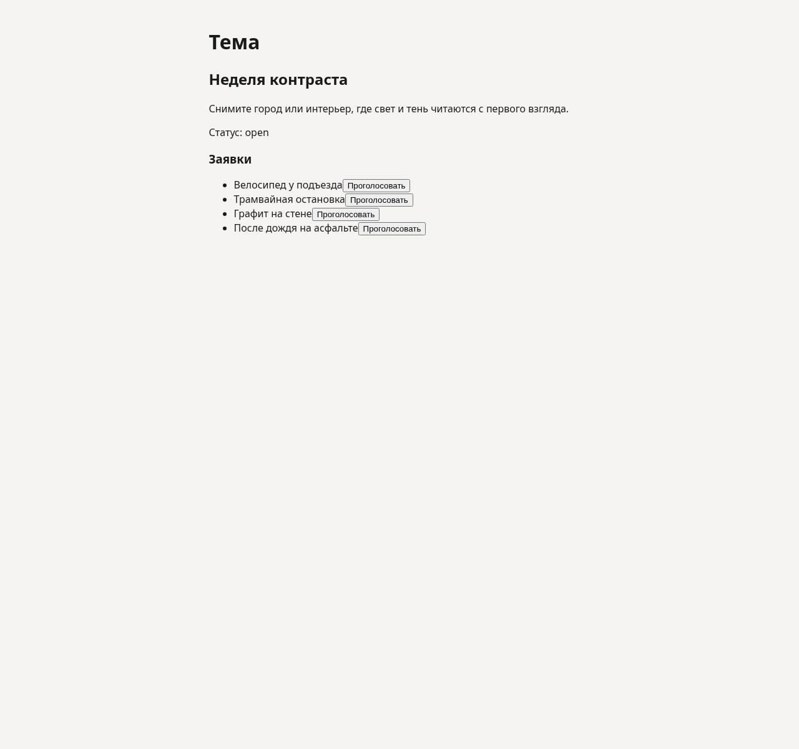
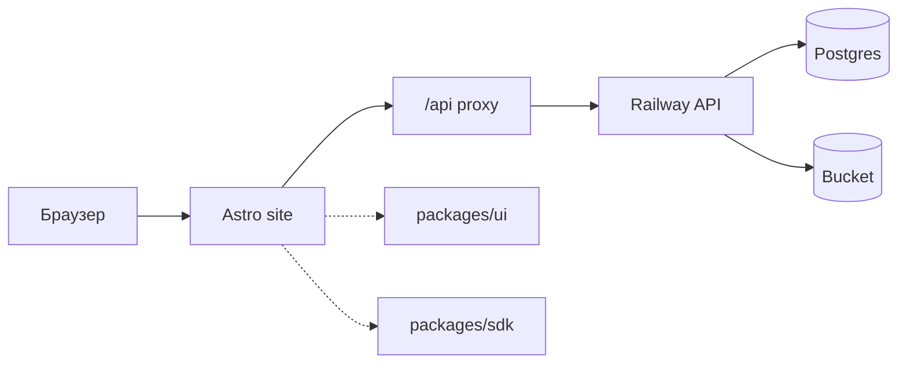

# Фото-кружок

Photo Kruzhok is a portfolio monorepo for a live photo-club demo. It contains a Django API, one Astro site with Vue islands, and shared `ui` and `sdk` packages.

[](https://github.com/aleksey-kerkin/photo-kruzhok/actions/workflows/ci.yml)
[](https://github.com/aleksey-kerkin/photo-kruzhok/actions/workflows/ci.yml)
[](https://github.com/aleksey-kerkin/photo-kruzhok/actions/workflows/ci.yml)

## Приложения

| Приложение | Локальный адрес |
| --- | --- |
| Сайт (сетка, посты, вход, панель) | http://localhost:4321 |
| API | http://127.0.0.1:8000 |

Репозиторий: `git@github.com:aleksey-kerkin/photo-kruzhok.git`

## Скриншоты

Витрина:



Сетка фото:


Пост с EXIF и комментариями:



Панель темы:



## Архитектура



## Локальный запуск

API, Postgres и MinIO поднимаются через Docker Compose. Сайт запускается на хосте:

```bash
docker compose up -d
pnpm --filter @photo-kruzhok/web dev
```

Порты: API `8000`, Postgres `5432`, MinIO `9000`, сайт `4321`. Секреты лежат в `.env` (шаблон — `.env.example`).

## Лицензия

Код распространяется по [PolyForm Strict License 1.0.0](LICENSE). Copyright © Aleksey Kerkin, 2024–2026.
