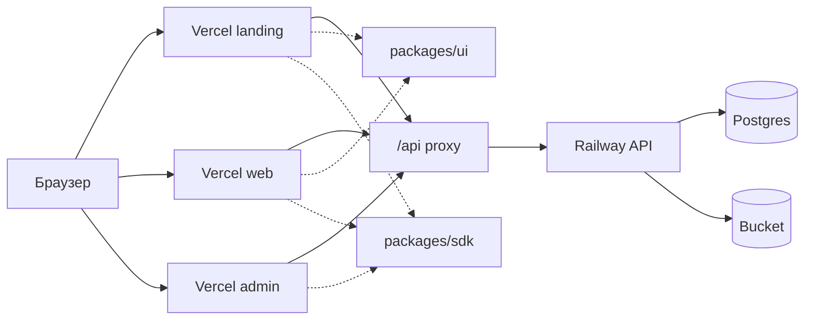

# Фото-кружок

Photo Kruzhok is a portfolio monorepo for a live photo-club demo. It contains a Django API, a React feed app, an Astro landing page, a Vue leader panel, and shared `ui` and `sdk` packages.

[](https://github.com/aleksey-kerkin/photo-kruzhok/actions/workflows/ci.yml)
[](https://github.com/aleksey-kerkin/photo-kruzhok/actions/workflows/ci.yml)
[](https://github.com/aleksey-kerkin/photo-kruzhok/actions/workflows/ci.yml)

## Приложения

| Приложение | Локальный адрес |
| --- | --- |
| Лендинг (витрина, анонсы, профили) | http://localhost:4321 |
| Лента и посты (React) | http://localhost:5173 |
| Панель темы (Vue) | http://localhost:5174 |

Репозиторий: `git@github.com:aleksey-kerkin/photo-kruzhok.git`

## Скриншоты

Витрина на лендинге:


Лента в React:


Пост с EXIF и комментариями:


Панель темы:


## Архитектура



## Локальный запуск

API, Postgres и MinIO поднимаются через Docker Compose. Фронтенды запускаются на хосте через `pnpm dev`, чтобы сохранить hot reload.

```bash
docker compose up -d
```

Порты: API `8000`, Postgres `5432`, MinIO `9000`, web `5173`, admin `5174`, landing `4321`. Секреты лежат в `.env` (шаблон — `.env.example`).

## Лицензия

Код распространяется по [PolyForm Strict License 1.0.0](LICENSE). Copyright © Aleksey Kerkin, 2024–2026.
